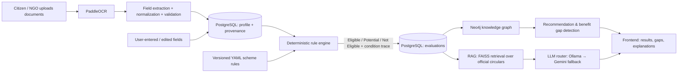
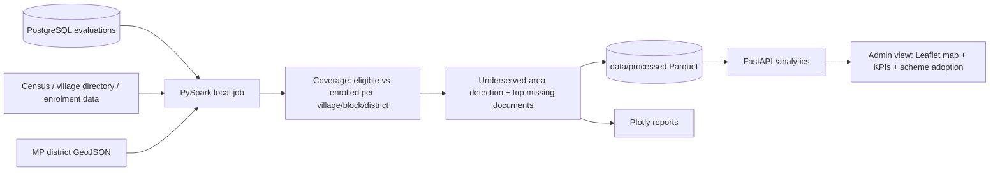

# AI Citizen Assistant — EPICS Welfare Intelligence Platform

> Working title. Candidate names: **GramPilot**, **SachivAI**.
>
> An AI-powered **Welfare Intelligence & Decision-Support Platform** that helps citizens, NGOs and district administrators find out which welfare schemes a person qualifies for, why, what is blocking them, and where coverage is weak.
>
> **Initial scope:** **Madhya Pradesh (MP) State and Central Government** welfare schemes, aimed mainly at rural and semi-urban citizens. The design can extend to other states later.

---

## 1. Project Overview & Vision

Millions of eligible citizens miss benefits they qualify for. The reasons are usually the same:

- **Scheme discovery is fragmented.** Eligibility rules are spread across department circulars, portals such as myScheme.gov.in and scholarshipportal.mp.nic.in, and Hindi/English PDFs.
- **Documents block benefits.** A missing caste certificate or an outdated income certificate can quietly stop a citizen from getting help they qualify for.
- **Complementary benefits go unclaimed.** For example, a student who qualifies for MMVY often also qualifies for hostel or laptop assistance and never hears about it.
- **Administrators can't see coverage.** Districts have no simple way to find villages or blocks where many eligible people are not enrolled.

### Why this is not a generic chatbot

A chatbot that "decides" eligibility can make things up, can't be audited, and can't be held accountable. This platform keeps **decisions** separate from **explanations**:

| Concern | Who handles it | Nature |
|---|---|---|
| Reading documents | PaddleOCR + field extraction + validation | Perception (probabilistic, confidence-scored) |
| **Deciding eligibility** | **Deterministic Python rule engine** | **Exact, versioned, auditable** |
| Finding related schemes and blocked benefits | Neo4j knowledge graph + recommendation module | Graph traversal (deterministic) |
| Explaining decisions in plain language | RAG (FAISS + LangChain + Ollama/Gemini) | Generative, based on official circulars |
| District coverage insights | PySpark + Pandas + Plotly | Batch analytics |

The LLM **only explains**. It never decides.

---

## 2. Core Engineering Principles

### 2.1 The deterministic rule engine is the only eligibility authority
- Every scheme is written as a machine-readable rule file (`ai_modules/rule_engine/rules/**.yaml`) with atomic conditions, such as `annual_income <= 600000`, `class12_percent >= 70` or `domicile == "MP"`.
- The engine evaluates each condition and records which ones passed, failed or were missing. Identical input always gives an identical result, so decisions can be reproduced and audited.
- **The LLM is never asked "is this person eligible?"** It receives the engine's finished result and explains it.

### 2.2 Data provenance separation
Every profile attribute carries a source tag. Rules can require a particular level of trust for a field.

| Tag | Meaning | Example |
|---|---|---|
| `OCR Extracted` | Read from an uploaded document by PaddleOCR, with a confidence score | Income ₹1,80,000 — 96% |
| `User Provided` / `User Edited` | Typed in or corrected by the citizen or an NGO volunteer | Occupation = Student |
| `Verified` | Validated against a trusted source or checked by an official (future integration) | Samagra ID matched |
| `Missing` | Not yet known | Ration card / SECC listing |

For example, if a user types "OBC" but has not uploaded a caste certificate, that category is `Unverified`. Caste-based conditions then return **Missing Info** and the condition is not treated as passed.

### 2.3 Uncertainty handling: missing information is not rejection
Each condition returns one of three results: `PASS`, `FAIL` or `MISSING`.

- Any `FAIL` → **Not Eligible**, and the exact failed condition is shown.
- No `FAIL` but at least one `MISSING` → **Potentially Eligible / Insufficient Info**, plus a **Benefit Gap** alert that names the document that would settle the question.
- All `PASS` → **Eligible**.

A citizen is never rejected just because something is unknown.

---

## 3. Confirmed Free & Open-Source Tech Stack

**Hardware target:** Intel i3 / Ryzen 3 or better, **8 GB RAM**, GPU optional. Every component is free and open source. Gemini API is an optional fallback that runs on the free tier.

| Layer | Technology | Role | Notes for 8 GB RAM |
|---|---|---|---|
| Frontend | React + Vite (**JavaScript `.jsx`**), Tailwind CSS, Lucide React | Citizen/NGO workflow and admin dashboard | Static build; no SSR |
| Maps | React-Leaflet + OpenStreetMap | District/village coverage map | Free tiles; no API key |
| API | Python + FastAPI | REST API, orchestration | Single Uvicorn worker |
| Document intelligence | PaddleOCR (CPU) + field extraction, normalization, validation | Reads certificates/marksheets | PP-OCR mobile models (~10–20 MB) |
| Relational DB | PostgreSQL | Citizen profiles, document metadata, scheme definitions, eligibility evaluations | ~200 MB RAM |
| Eligibility engine | Deterministic Python rule engine (YAML rules) | **Sole eligibility authority** | Pure Python, negligible RAM |
| Knowledge graph | Neo4j Community Edition | Citizens ↔ schemes ↔ conditions ↔ documents ↔ benefits ↔ regions ↔ complementary schemes | Heap capped at ~1 GB |
| RAG | LangChain + FAISS + Sentence Transformers | Retrieval over official circulars | `all-MiniLM-L6-v2` / multilingual MiniLM (CPU) |
| LLM (hybrid) | Ollama (local, e.g. 3B–4B quantized) + Gemini API (fallback) | Grounded explanations only | Q4 quantized local model ~2–3 GB |
| Recommendation | Python (graph queries + ranking) | Unclaimed schemes, complementary bundles, document-blocked benefits | — |
| Big data & geospatial analytics | Apache Spark / PySpark (local mode) + Pandas + Plotly | Village/block/district coverage, underserved-area detection | `local[2]`, 2 GB driver memory |
| Orchestration | Docker Compose | Runs Postgres, Neo4j, Ollama, API | Optional; services can also run natively |

---

## 4. Complete Repository & File Structure

> All files outside `README.md` and `frontend/` are **0-byte placeholders**. The descriptions below say what each file **will** contain.

```text
AI-Citizen-Assistant/
├── README.md                          # This document: vision, principles, stack, structure, workflow, setup
├── .gitignore                         # Ignore rules (node_modules, venv, .env, data artifacts, FAISS index, dist)
├── .env.example                       # Template for env vars (DB URLs, Neo4j creds, Ollama host, Gemini key)
├── docker-compose.yml                 # Local stack: PostgreSQL, Neo4j Community, Ollama, FastAPI backend
│
├── docs/
│   ├── architecture.md                # Module diagram, data flow, trust boundaries between rule engine and LLM
│   ├── api_spec.md                    # REST endpoint contracts (request/response shapes) for the frontend
│   ├── eligibility_rules.md           # Rule YAML grammar, operators, PASS/FAIL/MISSING semantics, versioning
│   ├── data_provenance.md             # OCR Extracted / User Provided / Verified / Missing tagging policy
│   └── deployment.md                  # Running on an 8 GB machine: memory caps, model choices, native vs Docker
│
├── backend/                           # FastAPI service (API layer + persistence + orchestration)
│   ├── Dockerfile                     # Backend container image
│   ├── requirements.txt               # FastAPI, SQLAlchemy, psycopg, Alembic, Pydantic, neo4j driver, pytest
│   ├── alembic.ini                    # Alembic migration configuration
│   ├── app/
│   │   ├── __init__.py                # Package marker
│   │   ├── main.py                    # FastAPI app factory, CORS, router mounting, startup hooks
│   │   ├── config.py                  # Settings loaded from environment (.env)
│   │   ├── database.py                # SQLAlchemy engine/session for PostgreSQL
│   │   ├── dependencies.py            # Shared FastAPI dependencies (DB session, service instances)
│   │   ├── api/
│   │   │   ├── __init__.py            # Package marker
│   │   │   ├── router.py              # Aggregates all route modules under /api/v1
│   │   │   └── routes/
│   │   │       ├── __init__.py        # Package marker
│   │   │       ├── documents.py       # Upload documents, trigger OCR, fetch extracted fields
│   │   │       ├── profiles.py        # Create/read/update citizen welfare profile with provenance
│   │   │       ├── eligibility.py     # Run deterministic evaluation for a profile
│   │   │       ├── recommendations.py # Benefit gaps, complementary schemes, document-blocked benefits
│   │   │       ├── explain.py         # RAG explanation + grounded Q&A for a scheme decision
│   │   │       └── analytics.py       # District/block/village coverage results for the admin view
│   │   ├── models/                    # SQLAlchemy ORM tables (PostgreSQL)
│   │   │   ├── __init__.py            # Package marker
│   │   │   ├── citizen.py             # Citizen profile + per-field provenance records
│   │   │   ├── document.py            # Uploaded document metadata, OCR status, confidences
│   │   │   ├── scheme.py              # Scheme definitions, rule version, benefits, department
│   │   │   └── evaluation.py          # Stored eligibility evaluations with condition-level results
│   │   ├── schemas/                   # Pydantic request/response models
│   │   │   ├── __init__.py            # Package marker
│   │   │   ├── citizen.py             # Profile + provenance-tagged field schemas
│   │   │   ├── document.py            # Upload / OCR result schemas
│   │   │   ├── scheme.py              # Scheme summary/detail schemas
│   │   │   ├── evaluation.py          # Eligible / Potential / Not Eligible result schemas
│   │   │   └── explanation.py         # RAG explanation, citations, Q&A schemas
│   │   ├── services/                  # Business logic that calls into ai_modules/
│   │   │   ├── __init__.py            # Package marker
│   │   │   ├── document_service.py    # Stores files, runs OCR pipeline, merges fields into profile
│   │   │   ├── profile_service.py     # Profile CRUD, provenance transitions (OCR → User Edited → Verified)
│   │   │   ├── eligibility_service.py # Loads rules, invokes rule engine, persists evaluations
│   │   │   ├── recommendation_service.py # Calls KG + gap detector, ranks opportunities
│   │   │   ├── explanation_service.py # Builds RAG context from engine output, calls LLM router
│   │   │   └── analytics_service.py   # Serves precomputed PySpark coverage outputs
│   │   └── utils/
│   │       ├── __init__.py            # Package marker
│   │       ├── provenance.py          # Provenance enums and trust-level helpers
│   │       └── logger.py              # Structured logging setup
│   ├── migrations/
│   │   ├── env.py                     # Alembic environment
│   │   └── versions/.gitkeep          # Migration scripts directory
│   └── tests/
│       ├── __init__.py                # Package marker
│       ├── conftest.py                # Pytest fixtures (test DB, sample citizen)
│       ├── test_documents.py          # Upload/OCR endpoint tests
│       ├── test_eligibility.py        # Rule engine decision tests (PASS/FAIL/MISSING)
│       ├── test_recommendations.py    # Benefit gap + complementary scheme tests
│       └── test_explain.py            # Explanation grounding/citation tests
│
├── ai_modules/                        # Independent AI & data pipelines (importable by backend and scripts)
│   ├── __init__.py                    # Package marker
│   ├── requirements.txt               # PaddleOCR, LangChain, FAISS, sentence-transformers, PySpark, Plotly
│   ├── ocr/                           # Document intelligence
│   │   ├── __init__.py                # Package marker
│   │   ├── paddle_engine.py           # PaddleOCR wrapper (CPU, lazy-loaded models)
│   │   ├── field_extractor.py         # Template/regex/keyword extraction of fields from OCR text
│   │   ├── normalizer.py              # Normalizes dates, ₹ amounts, names, districts, Hindi↔English labels
│   │   ├── validator.py               # Field validation + confidence thresholds → provenance tag
│   │   └── templates/
│   │       ├── mp_income_certificate.yaml # Field map for MP income certificate
│   │       ├── caste_certificate.yaml     # Field map for caste certificate (SC/ST/OBC)
│   │       ├── samagra_domicile.yaml      # Field map for Samagra ID / domicile certificate
│   │       └── class12_marksheet.yaml     # Field map for MP Board / CBSE Class 12 marksheet
│   ├── rule_engine/                   # Deterministic eligibility engine (sole authority)
│   │   ├── __init__.py                # Package marker
│   │   ├── engine.py                  # Evaluates a profile against a scheme rule set
│   │   ├── operators.py               # Comparison/membership operators with MISSING semantics
│   │   ├── loader.py                  # Loads + validates versioned YAML rule files
│   │   ├── result.py                  # Condition/scheme result data structures
│   │   └── rules/
│   │       ├── central/
│   │       │   ├── pm_kisan.yaml               # PM-KISAN income support for landholding farmer families
│   │       │   ├── pm_jay.yaml                 # Ayushman Bharat PM-JAY health cover
│   │       │   ├── pmay_gramin.yaml            # PM Awas Yojana – Gramin housing
│   │       │   └── post_matric_scholarship.yaml # Post-Matric Scholarship (SC/ST/OBC)
│   │       └── mp/
│   │           ├── mmvy.yaml                   # Mukhyamantri Medhavi Vidyarthi Yojana
│   │           ├── gaon_ki_beti.yaml           # MP Gaon Ki Beti Yojana
│   │           ├── hostel_assistance.yaml      # MP hostel / accommodation assistance
│   │           └── laptop_protsahan.yaml       # MP Laptop Protsahan Yojana
│   ├── knowledge_graph/               # Neo4j Community Edition
│   │   ├── __init__.py                # Package marker
│   │   ├── neo4j_client.py            # Driver/session management
│   │   ├── graph_builder.py           # Builds nodes/edges from scheme rules + evaluations
│   │   ├── queries.py                 # Cypher queries: complementary schemes, doc-blocked benefits, regions
│   │   └── cypher/
│   │       ├── schema.cypher          # Constraints/indexes (Citizen, Scheme, Condition, Document, Benefit, Region)
│   │       └── seed.cypher            # Seed scheme graph for MP + Central schemes
│   ├── rag/                           # Retrieval-augmented explainability
│   │   ├── __init__.py                # Package marker
│   │   ├── ingest.py                  # Loads official circulars/PDFs from data/raw/circulars
│   │   ├── chunker.py                 # Section-aware chunking with source metadata
│   │   ├── embedder.py                # Sentence Transformers embedding (CPU)
│   │   ├── vector_store.py            # FAISS index build/load/persist (data/vector_index)
│   │   ├── retriever.py               # Hybrid retrieval filtered by scheme + citation metadata
│   │   ├── llm_router.py              # Ollama-first, Gemini-fallback LLM routing
│   │   └── prompts.py                 # Grounded prompt templates (explain-only, must cite sources)
│   ├── recommendation/                # Benefit gap detection
│   │   ├── __init__.py                # Package marker
│   │   ├── gap_detector.py            # Unclaimed eligible schemes + document-blocked benefits
│   │   ├── complementary.py           # Complementary scheme bundles via KG traversal
│   │   └── ranker.py                  # Ranks opportunities by benefit value and effort to unlock
│   └── analytics/                     # Big data & geospatial analytics
│       ├── __init__.py                # Package marker
│       ├── spark_session.py           # Local-mode SparkSession tuned for 8 GB RAM
│       ├── coverage_job.py            # Eligible vs enrolled coverage per village/block/district
│       ├── underserved_detection.py   # Flags underserved areas + top missing documents
│       └── plotly_reports.py          # Plotly charts/exports for admin reports
│
├── data/
│   ├── raw/
│   │   ├── circulars/.gitkeep         # Official govt circulars / guideline PDFs (RAG source)
│   │   ├── schemes/.gitkeep           # Raw scheme metadata (myScheme, MP portals)
│   │   ├── sample_documents/.gitkeep  # Synthetic sample certificates for OCR testing (no real PII)
│   │   └── census/.gitkeep            # Census / village directory / enrolment datasets
│   ├── processed/.gitkeep             # Cleaned Parquet/CSV outputs from pipelines
│   ├── vector_index/.gitkeep          # Persisted FAISS index + metadata
│   └── geo/mp_districts.geojson       # MP district boundaries for maps and spatial joins
│
├── scripts/
│   ├── seed_database.py               # Seeds PostgreSQL with scheme definitions + sample citizens
│   ├── build_vector_index.py          # Ingest circulars → chunk → embed → FAISS
│   ├── load_knowledge_graph.py        # Loads scheme graph into Neo4j
│   └── run_district_analytics.py      # Runs PySpark coverage + underserved-area jobs
│
└── frontend/                          # React + Vite (JavaScript) prototype — IMPLEMENTED
    ├── package.json                   # Dependencies + scripts (dev/build/preview)
    ├── vite.config.js                 # Vite + React + Tailwind CSS plugin config
    ├── index.html                     # HTML entry
    ├── public/favicon.svg             # App icon
    └── src/
        ├── main.jsx                   # React root mount
        ├── App.jsx                    # Shell: top nav + mode switching
        ├── index.css                  # Tailwind import + base styles
        ├── data/mockData.js           # Mock MP/Central schemes, sample citizen docs, KG links, RAG text, district stats
        ├── lib/eligibility.js         # Deterministic mock evaluator mirroring the planned rule engine (PASS/FAIL/MISSING)
        ├── components/
        │   ├── TopNav.jsx             # Mode switcher: Citizen & NGO Discovery / District Analytics
        │   ├── Badge.jsx              # Provenance + status badges
        │   ├── citizen/
        │   │   ├── DocumentUpload.jsx     # Step 1: dropzone, sample docs toggle, simulated PaddleOCR
        │   │   ├── ProfilePanel.jsx       # Step 2: editable profile with provenance badges
        │   │   ├── EligibilityResults.jsx # Step 3: Eligible / Potential / Not Eligible tabs
        │   │   ├── SchemeCard.jsx         # Scheme card: satisfied / failed / missing conditions + Explain
        │   │   ├── BenefitGaps.jsx        # Step 4: KG complementary schemes + document-blocked benefits
        │   │   └── RagDrawer.jsx          # Step 5: slide-over grounded explanation, checklist, citations, Q&A
        │   └── admin/
        │       ├── DistrictMap.jsx        # React-Leaflet OSM map of MP districts with coverage circles
        │       ├── KpiCards.jsx           # Coverage KPI cards
        │       └── SchemeAdoption.jsx     # Scheme adoption breakdown bars
        └── pages/
            ├── CitizenDiscovery.jsx   # Citizen/NGO pipeline page (Steps 1–5)
            └── AdminAnalytics.jsx     # District & village analytics page
```

---

## 5. End-to-End System Workflow

### 5.1 Citizen Discovery Pipeline (online, per citizen)



1. **Upload:** income, caste, Samagra/domicile and marksheet documents are uploaded through `POST /documents`.
2. **OCR:** PaddleOCR reads the text. `field_extractor` maps it to fields such as income or category. `normalizer` cleans up formats, and `validator` attaches a confidence score and a provenance tag.
3. **Profile:** extracted fields are merged into the citizen profile. Fields the user edits are re-tagged. Missing fields stay `Missing` and are never guessed.
4. **Evaluate:** the rule engine runs every applicable MP and Central rule set and returns PASS/FAIL/MISSING for each condition, along with a scheme status.
5. **Graph and gaps:** the evaluation is linked into Neo4j. Graph queries find complementary schemes (e.g. MMVY → hostel assistance), document-blocked benefits (e.g. upload a caste certificate → Post-Matric Scholarship), and eligible schemes not yet claimed.
6. **Explain:** for a chosen scheme, the retriever pulls the relevant passages from official circulars. The LLM gets the engine's condition trace plus those passages, and writes a plain-language explanation with citations, a document checklist and application steps. It cannot change the decision.

### 5.2 District Analytics Pipeline (batch, admin)



1. `scripts/run_district_analytics.py` starts Spark in local mode with settings that fit 8 GB of RAM.
2. Evaluations are joined with population and enrolment data, then grouped at village, block and district level.
3. Areas with low coverage or a large gap between eligible and enrolled people are flagged, together with the documents that most often block benefits there.
4. Results are written to `data/processed/` and served to the admin map and dashboard.

---

## 6. Current Implementation Status & Setup

### Status

| Area | Status |
|---|---|
| Repository skeleton | ✅ Created |
| `README.md` | ✅ Written |
| `frontend/` | ✅ Basic prototype with **mock data** (no backend calls) |
| `backend/`, `ai_modules/`, `data/`, `scripts/`, `docs/`, root config files | ⏳ **0-byte placeholders**, not implemented yet |

The frontend runs a small JavaScript stand-in for the rule engine (`src/lib/eligibility.js`) using the same PASS/FAIL/MISSING logic, so the workflow responds to input during demos. The real decisions will come from the Python rule engine once it is built.

### Run the frontend prototype

Requirements: Node.js 18+ (20 LTS or newer recommended).

```bash
cd frontend && npm install && npm run dev
```

Then open the URL Vite prints (normally http://localhost:5173).

Production build check:

```bash
cd frontend && npm run build && npm run preview
```

### Demo script
1. **Citizen & NGO Discovery** → click **Load Sample MP Citizen Demo**.
2. Look at the provenance badges in Step 2, then raise **Annual Income** above ₹6,00,000. MMVY and the Post-Matric Scholarship move to **Not Eligible**.
3. Remove the **Caste Certificate**. The Post-Matric Scholarship moves to **Potentially Eligible**, and Step 4 shows a document-blocked benefit.
4. Click **Explain via RAG** on any scheme to open the explanation drawer.
5. Switch to **District & Village Analytics** to see coverage circles for MP districts on the OpenStreetMap view.

---

## 7. Disclaimer
All scheme criteria, amounts and district statistics in the prototype are **illustrative mock data** for an academic EPICS project. Always check eligibility against official notifications from the Government of Madhya Pradesh and the Government of India.
