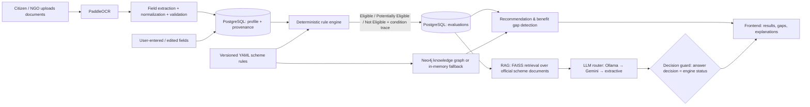
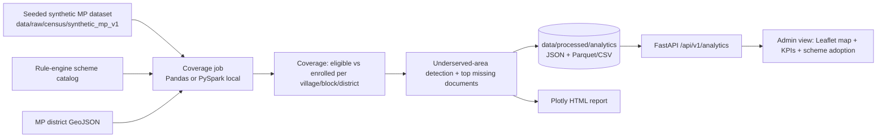

# AI Citizen Assistant — EPICS Welfare Intelligence Platform

> Working title. Candidate names: **GramPilot**, **SachivAI**.
>
> An AI-powered **Welfare Intelligence & Decision-Support Platform** that helps citizens, NGOs and district administrators find out which welfare schemes a person qualifies for, why, what is blocking them, and where coverage is weak.
>
> **Initial scope:** **Madhya Pradesh (MP) State and Central Government** welfare schemes, aimed mainly at rural and semi-urban citizens. The design can extend to other states later.

---

## 1. Project Overview & Vision

Millions of eligible citizens miss benefits they qualify for. The reasons are usually the same:

- **Scheme discovery is fragmented.** Eligibility rules are spread across department circulars, portals such as myScheme.gov.in and scholarshipportal.mp.nic.in, and Hindi/English PDFs.
- **Documents block benefits.** A missing caste certificate or an outdated income certificate can quietly stop a citizen from getting help they qualify for.
- **Complementary benefits go unclaimed.** For example, a student who qualifies for MMVY often also qualifies for hostel or laptop assistance and never hears about it.
- **Administrators can't see coverage.** Districts have no simple way to find villages or blocks where many eligible people are not enrolled.

### Why this is not a generic chatbot

A chatbot that "decides" eligibility can make things up, can't be audited, and can't be held accountable. This platform keeps **decisions** separate from **explanations**:

| Concern | Who handles it | Nature |
|---|---|---|
| Reading documents | PaddleOCR + field extraction + validation | Perception (probabilistic, confidence-scored) |
| **Deciding eligibility** | **Deterministic Python rule engine** | **Exact, versioned, auditable** |
| Finding related schemes and blocked benefits | Neo4j knowledge graph + recommendation module | Graph traversal (deterministic) |
| Explaining decisions in plain language | RAG (FAISS + sentence-transformers + Ollama, optional Gemini) | Generative, grounded in official scheme documents |
| District coverage insights | PySpark + Pandas + Plotly | Batch analytics |

The LLM **only explains**. It never decides.

---

## 2. Core Engineering Principles

### 2.1 The deterministic rule engine is the only eligibility authority
- Every scheme is a machine-readable, versioned rule file (`ai_modules/rule_engine/rules/{central,mp}/*.yaml`). It is built from atomic conditions such as `annual_family_income lt 800000`, `class12_percentage gte 70` or `domicile_state eq "Madhya Pradesh"`, each with a minimum trust level and the documents that can resolve it.
- The engine evaluates each condition and records which ones passed, failed or were missing. Identical input always gives an identical result, so decisions can be reproduced and audited.
- **The LLM is never asked "is this person eligible?"** It receives the engine's finished result and explains it.

### 2.2 Data provenance separation
Every profile attribute carries a source tag. Rules can require a particular level of trust for a field.

| Provenance (API value) | Meaning | Example | UI badge |
|---|---|---|---|
| `document_extracted` | Read from an uploaded document by PaddleOCR, with a confidence score in `[0, 1]` | Income ₹4,16,000 at 0.93 | `OCR Extracted · 93%` |
| `self_declared` | Typed in or corrected by the citizen or an NGO volunteer | Occupation = student | `User Entered` / `User Edited` |
| `verified` | Confirmed against a trusted source or by an official. Defined, but no integration sets it yet | — | `Verified` |
| *(absent)* | Not yet known; listed in the profile's `missing_fields` | Ration card / SECC listing | `Missing` |

For example, if a user types "OBC" but has not uploaded a caste certificate, that category is `self_declared`. Caste conditions require `document_extracted`, so they return **MISSING** (`insufficient_trust`), not PASS. Full policy: [`docs/data_provenance.md`](docs/data_provenance.md).

### 2.3 Uncertainty handling: missing information is not rejection
Each condition returns one of three results: `PASS`, `FAIL` or `MISSING`.

- Any `FAIL` → **Not Eligible**, and the exact failed condition is shown.
- No `FAIL` but at least one `MISSING` → **Potentially Eligible / Insufficient Info**, plus a **Benefit Gap** alert that names the document that would settle the question.
- All `PASS` → **Eligible**.

A citizen is never rejected just because something is unknown.

---

## 3. Tech Stack (as implemented)

**Hardware target:** Intel i3 / Ryzen 3 or better, **8 GB RAM**, GPU optional. Every component is free and open source. Gemini is an optional free-tier fallback and is off unless `GEMINI_API_KEY` is set.

| Layer | Technology | Role | Notes for 8 GB RAM |
|---|---|---|---|
| Frontend | React 19 + Vite 6 (JavaScript `.jsx`), Tailwind CSS 4, Lucide React | Citizen/NGO workflow and admin dashboard | Still on mock data; integration: [`docs/frontend_integration_guide.md`](docs/frontend_integration_guide.md) |
| Maps | React-Leaflet + OpenStreetMap | District coverage map | Free tiles; no API key |
| API | Python 3.11 + FastAPI + Pydantic v2 | REST API (`/api/v1`, 31 operations), OpenAPI at `/docs` | Single Uvicorn worker |
| Relational DB | PostgreSQL 16 + SQLAlchemy 2 + Alembic | Citizens, provenance-tagged profile fields, document metadata, scheme rule versions, evaluations, audit log | Docker, capped at 512 MB |
| Eligibility engine | Deterministic Python rule engine over versioned YAML rules | **Sole eligibility authority**: 9 MP + central schemes, 10 rule versions | Pure Python |
| Document intelligence | PaddleOCR 3.x (PP-OCRv5 mobile detection + English and Devanagari recognition), PyMuPDF, YAML field templates | Reads income, caste, Samagra/domicile and Class 12 documents | CPU; models 21 MB; about 3–7 s per page |
| Knowledge graph | Neo4j 5 Community (in-memory fallback with identical results) | Schemes ↔ conditions ↔ documents ↔ fields ↔ benefits ↔ regions, complementary/top-up edges | Heap capped at 1 GB; optional (`KG_USE_NEO4J=false`) |
| Recommendation | Python (gap detection, ranking, totals) | Unclaimed schemes, next actions, document gaps, complementary schemes | — |
| RAG | FAISS (CPU) + sentence-transformers `paraphrase-multilingual-MiniLM-L12-v2` + LangChain text splitters | Retrieval over 25 official government documents (571 chunks) | Index 1.5 MB; model about 470 MB |
| LLM (explanations only) | Ollama (`qwen2.5:3b-instruct` on 8 GB / `qwen2.5:7b-instruct` with a GPU) → Gemini → extractive fallback | Grounded explanations with citations; never decides | 3B Q4 needs about 2.5 GB |
| Analytics | Pandas (default) or Apache Spark / PySpark (3.5–4.0; local mode, needs Java 17) + Plotly | District/block/village coverage and underserved areas on **synthetic** data | Pandas run about 3 s; Spark `local[2]` |
| Orchestration | Docker Compose | PostgreSQL, Neo4j; optional backend and Ollama profiles | Services can also run natively |

---

## 4. Repository Structure

Generated from the repository (git-tracked and new files; excludes `node_modules/`, `.venv/`, caches and git-ignored data outputs such as `data/vector_index/*`, `data/processed/analytics/`, `data/raw/census/synthetic_mp_v1/` and downloaded circulars). Test files are listed without comments.

```text
AI-Citizen-Assistant/
├── .dockerignore                                           # Files excluded from the backend image build
├── .env.example                                            # Template for every env var (copy to .env; never commit .env)
├── .gitignore                                              # Ignore rules (node_modules, .venv, .env, data outputs, FAISS index, downloaded circulars)
├── docker-compose.yml                                      # PostgreSQL 16 (host 5433), Neo4j 5 Community; profiles: app (backend), llm (Ollama)
├── pyproject.toml                                          # Ruff + pytest configuration (markers: integration, slow)
├── README.md                                               # This document
├── .github/
│   └── workflows/
│       └── ci.yml                                          # CI: ruff, gitleaks, pip-audit, backend tests (PostgreSQL + Neo4j services), analytics, AI modules
├── ai_modules/
│   ├── __init__.py
│   ├── requirements.txt                                    # PaddleOCR, PyMuPDF, sentence-transformers, FAISS, LangChain splitters, PySpark, Pandas, Plotly
│   ├── analytics/
│   │   ├── __init__.py
│   │   ├── coverage_job.py                                 # Coverage metrics (pandas or Spark)
│   │   ├── outputs.py                                      # Output writing + load_outputs() for the API
│   │   ├── pipeline.py                                     # End-to-end batch run
│   │   ├── plotly_reports.py                               # Offline Plotly HTML report
│   │   ├── reference.py                                    # District / scheme reference data
│   │   ├── spark_session.py                                # Local Spark session (Windows path workaround)
│   │   ├── synthetic.py                                    # Seeded synthetic MP dataset (labelled)
│   │   ├── underserved_detection.py                        # Underserved districts / blocks / villages
│   │   └── tests/
│   │       ├── __init__.py
│   │       ├── conftest.py
│   │       ├── test_analytics_coverage.py
│   │       ├── test_analytics_outputs.py
│   │       ├── test_analytics_spark.py
│   │       ├── test_analytics_synthetic.py
│   │       └── test_analytics_underserved.py
│   ├── knowledge_graph/
│   │   ├── __init__.py                                     # KnowledgeGraph facade (Neo4j or fallback)
│   │   ├── fallback.py                                     # InMemoryGraph with identical query semantics
│   │   ├── graph_builder.py                                # Graph spec from rules + districts; seeding
│   │   ├── models.py                                       # Result types (SchemeEdge, DocumentUnlock, …)
│   │   ├── neo4j_client.py                                 # Driver settings, availability, Cypher file parsing
│   │   ├── queries.py                                      # Parametrised Cypher queries
│   │   ├── cypher/
│   │   │   ├── schema.cypher                               # Constraints and indexes
│   │   │   └── seed.cypher                                 # Named seed / prune statements
│   │   └── tests/
│   │       ├── __init__.py
│   │       ├── synthetic_rules.py
│   │       ├── test_kg_fallback.py
│   │       ├── test_kg_graph_builder.py
│   │       └── test_kg_neo4j_integration.py
│   ├── ocr/
│   │   ├── __init__.py
│   │   ├── documents.py                                    # Magic-byte sniffing, image/PDF loading, PDF text layer, limits
│   │   ├── errors.py                                       # OCR error hierarchy
│   │   ├── field_extractor.py                              # Template-driven field extraction, document classification
│   │   ├── normalizer.py                                   # INR amounts, MP districts, Hindi↔English labels, names
│   │   ├── paddle_engine.py                                # PaddleOCR 3.x wrapper (PP-OCRv5 mobile det + en/hi rec), --download CLI
│   │   ├── pipeline.py                                     # process_document(): load → OCR → classify → extract → validate
│   │   ├── synthetic.py                                    # Synthetic watermarked certificate generator
│   │   ├── validator.py                                    # ExtractedField, plausibility checks, review threshold
│   │   ├── templates/
│   │   │   ├── caste_certificate.yaml                      # Caste certificate field map
│   │   │   ├── class12_marksheet.yaml                      # Class 12 marksheet field map
│   │   │   ├── mp_income_certificate.yaml                  # MP income certificate field map
│   │   │   └── samagra_domicile.yaml                       # Samagra / domicile field map
│   │   └── tests/
│   │       ├── __init__.py
│   │       ├── test_ocr_end_to_end.py
│   │       ├── test_ocr_extraction.py
│   │       ├── test_ocr_inputs.py
│   │       └── test_ocr_normalizer.py
│   ├── rag/
│   │   ├── __init__.py
│   │   ├── chunker.py                                      # Section-aware chunking with source metadata
│   │   ├── embedder.py                                     # Multilingual MiniLM embeddings (CPU)
│   │   ├── ingest.py                                       # Downloads/verifies official documents from the manifest
│   │   ├── llm_router.py                                   # Ollama → Gemini → none
│   │   ├── prompts.py                                      # Explain-only grounded prompts (en/hi)
│   │   ├── retriever.py                                    # Scheme-filtered retrieval, min-score threshold
│   │   ├── service.py                                      # ExplanationService: refusal, citations, contradiction guard
│   │   ├── vector_store.py                                 # FAISS index build / load
│   │   └── tests/
│   │       ├── __init__.py
│   │       ├── conftest.py
│   │       ├── test_rag_ingest_chunker.py
│   │       ├── test_rag_ollama_integration.py
│   │       ├── test_rag_retriever.py
│   │       ├── test_rag_service.py
│   │       └── test_rag_vector_store.py
│   ├── recommendation/
│   │   ├── __init__.py
│   │   ├── complementary.py                                # Complementary candidates from graph edges
│   │   ├── gap_detector.py                                 # Missing items → next actions, document gaps
│   │   ├── ranker.py                                       # Ranking with reasons
│   │   ├── report.py                                       # build_recommendations(): report + totals
│   │   └── tests/
│   │       ├── __init__.py
│   │       ├── factories.py
│   │       ├── test_recommendation_gaps.py
│   │       ├── test_recommendation_real_rules.py
│   │       └── test_recommendation_report.py
│   └── rule_engine/
│       ├── __init__.py
│       ├── definitions.py                                  # SchemeRule / Condition / Group / Benefit dataclasses and enums
│       ├── engine.py                                       # RuleEngine: effective versions, evaluate, input hashes
│       ├── fields.py                                       # Profile field catalog, document types, provenance + trust
│       ├── loader.py                                       # Strict YAML loading, validation, rule hashes
│       ├── operators.py                                    # Typed operators with MISSING semantics
│       ├── result.py                                       # Outcome, MissingReason, EligibilityStatus, ConditionResult, SchemeEvaluation
│       ├── rules/
│       │   ├── central/
│       │   │   ├── pm_jay.yaml                             # Ayushman Bharat PM-JAY (2024.1)
│       │   │   ├── pm_kisan.yaml                           # PM-KISAN (2020.1, verified)
│       │   │   └── pmay_gramin.yaml                        # PMAY-Gramin (2024.1, verified)
│       │   └── mp/
│       │       ├── gaon_ki_beti.yaml                       # Gaon Ki Beti Yojana (2005.1)
│       │       ├── hostel_assistance.yaml                  # Awas Sahayata, SC/ST students (2016.1)
│       │       ├── laptop_protsahan.yaml                   # Laptop incentive (2026.1, from 2026-08-31)
│       │       ├── laptop_protsahan_2025.yaml              # Laptop incentive (2025.1, until 2026-08-30)
│       │       ├── mmvy.yaml                               # Mukhyamantri Medhavi Vidyarthi Yojana (2026.1, verified)
│       │       ├── mp_kisan_kalyan.yaml                    # Mukhyamantri Kisan Kalyan Yojana (2024.1; tops up PM-KISAN)
│       │       └── post_matric_scholarship_obc.yaml        # MP Post-Matric Scholarship OBC (2018.1)
│       └── tests/
│           ├── __init__.py
│           ├── rule_factory.py
│           ├── test_rule_engine_semantics.py
│           ├── test_rule_loader.py
│           ├── test_rule_operators.py
│           └── test_rule_real_files.py
├── backend/
│   ├── alembic.ini                                         # Alembic configuration
│   ├── Dockerfile                                          # Backend image (core API; --build-arg INSTALL_AI=true adds OCR/RAG/Spark)
│   ├── requirements-dev.txt                                # pytest, ruff
│   ├── requirements.txt                                    # FastAPI, SQLAlchemy, psycopg, Alembic, Pydantic, neo4j driver, httpx
│   ├── app/
│   │   ├── __init__.py
│   │   ├── config.py                                       # Settings from environment / .env
│   │   ├── database.py                                     # SQLAlchemy engine, session factory, get_db
│   │   ├── dependencies.py                                 # Rule engine / knowledge graph / explainer dependencies
│   │   ├── errors.py                                       # ApiError + single error envelope {error: {code, message, details}}
│   │   ├── main.py                                         # App factory: CORS, request-id + body-size middleware, lifespan (rules, graph)
│   │   ├── api/
│   │   │   ├── __init__.py
│   │   │   ├── router.py                                   # Mounts all route modules under /api/v1
│   │   │   └── routes/
│   │   │       ├── __init__.py
│   │   │       ├── analytics.py                            # /analytics/* (synthetic outputs)
│   │   │       ├── documents.py                            # Certificate upload (OCR), list, get, delete
│   │   │       ├── eligibility.py                          # Persisted and stateless evaluations
│   │   │       ├── explain.py                              # Citizen explanation, /explain, /schemes/{id}/ask
│   │   │       ├── health.py                               # /health, /ready
│   │   │       ├── profiles.py                             # /profile-fields, /citizens, profile, enrollments
│   │   │       ├── recommendations.py                      # /citizens/{id}/recommendations
│   │   │       └── schemes.py                              # /schemes, /schemes/{id}
│   │   ├── models/
│   │   │   ├── __init__.py
│   │   │   ├── audit.py                                    # audit_log (no personal values)
│   │   │   ├── citizen.py                                  # citizens, profile_fields (value + provenance), benefit_enrollments
│   │   │   ├── common.py                                   # Shared ORM helpers (provenance check constraints)
│   │   │   ├── document.py                                 # documents (metadata, OCR fields, unique citizen+sha256)
│   │   │   ├── evaluation.py                               # eligibility_evaluations, condition_results
│   │   │   └── scheme.py                                   # schemes, scheme_rule_versions
│   │   ├── schemas/
│   │   │   ├── __init__.py
│   │   │   ├── analytics.py                                # Analytics response models
│   │   │   ├── citizen.py                                  # Citizen, profile, catalog, enrollment models
│   │   │   ├── common.py                                   # ErrorResponse + shared OpenAPI error entries
│   │   │   ├── document.py                                 # Upload / document metadata models
│   │   │   ├── evaluation.py                               # Evaluation request/response models
│   │   │   ├── explanation.py                              # Explanation / Q&A models
│   │   │   ├── recommendation.py                           # Recommendation report models
│   │   │   └── scheme.py                                   # Scheme summary / detail models
│   │   ├── services/
│   │   │   ├── __init__.py
│   │   │   ├── analytics_service.py                        # Loads analytics JSON outputs (mtime cache)
│   │   │   ├── audit_service.py                            # Writes audit rows
│   │   │   ├── document_service.py                         # Upload limits, type sniffing, OCR call, provenance merge, dedup
│   │   │   ├── eligibility_service.py                      # Runs the rule engine, persists runs + condition rows
│   │   │   ├── explanation_service.py                      # RAG service lifecycle, decision guard, rag_status
│   │   │   ├── profile_service.py                          # Citizen/profile CRUD, validation, identity-number guard, enrollments
│   │   │   ├── recommendation_service.py                   # Latest run + enrollments + KG edges → build_recommendations
│   │   │   ├── rules_state.py                              # Startup: load rules, sync to DB, connect knowledge graph
│   │   │   └── scheme_service.py                           # Scheme serialization, rule-version sync
│   │   └── utils/
│   │       ├── __init__.py
│   │       ├── logger.py                                   # JSON logging with request ids
│   │       └── provenance.py                               # Provenance transitions (user edit, OCR extraction)
│   ├── migrations/
│   │   ├── env.py                                          # Alembic environment
│   │   ├── script.py.mako
│   │   └── versions/
│   │       ├── 20261118_414654505a8d_initial_schema.py     # Initial schema
│   │       └── 20261118_6cc2e7e4d5a8_document_ocr_metadata.py# Document OCR metadata + unique (citizen_id, sha256)
│   └── tests/
│       ├── __init__.py
│       ├── conftest.py                                     # Test DB (aca_test), client and synthetic fixtures
│       ├── test_analytics.py
│       ├── test_documents.py
│       ├── test_eligibility.py
│       ├── test_errors_and_privacy.py
│       ├── test_explain.py
│       ├── test_health.py
│       ├── test_migrations.py
│       ├── test_profiles.py
│       └── test_recommendations.py
├── data/
│   ├── geo/
│   │   ├── mp_districts.geojson                            # MP districts (DataMeet, CC BY 2.5 IN; simplified)
│   │   └── README.md                                       # GeoJSON attribution and changes
│   ├── processed/
│   │   └── .gitkeep
│   ├── raw/
│   │   ├── census/
│   │   │   ├── .gitignore                                  # Ignores the generated synthetic dataset
│   │   │   ├── .gitkeep
│   │   │   └── README.md                                   # Synthetic dataset description
│   │   ├── circulars/
│   │   │   ├── .gitignore                                  # Ignores downloaded PDFs/HTML
│   │   │   ├── .gitkeep
│   │   │   └── manifest.yaml                               # Official RAG sources with pinned hashes
│   │   ├── sample_documents/
│   │   │   └── …                                           # Synthetic watermarked certificates: 4 types × en/bilingual × PNG/PDF + ground-truth JSON (24 files + .gitkeep)
│   │   └── schemes/
│   │       └── .gitkeep
│   └── vector_index/
│       └── .gitkeep
├── docs/
│   ├── api_spec.md                                         # Endpoint table (method, path, status, error codes) + conventions
│   ├── architecture.md                                     # Components, request flows, trust boundaries, data stores, failure modes, module map
│   ├── backend_implementation_plan.md                      # Module checklist, interface contracts, delivered scope, limitations
│   ├── data_provenance.md                                  # Provenance levels/transitions and sensitive-data policy
│   ├── deployment.md                                       # Local setup on an 8 GB machine: Docker, migrations, models, index, analytics, tests
│   ├── eligibility_rules.md                                # Rule YAML grammar + per-scheme official sources, verification status, limitations
│   ├── frontend_integration_guide.md                       # How the React app connects: endpoints per UI step, mock→API mapping, fetch helpers
│   ├── openapi.json                                        # OpenAPI 3.1 schema exported from FastAPI (31 operations)
│   └── fixtures/
│       └── …                                               # Real API responses captured from the running server (40 JSON files)
├── frontend/
│   ├── index.html                                          # HTML entry
│   ├── package-lock.json
│   ├── package.json                                        # Dependencies + scripts (dev/build/preview)
│   ├── vite.config.js                                      # Vite + React + Tailwind plugin
│   ├── public/
│   │   └── favicon.svg
│   └── src/
│       ├── App.jsx                                         # Shell: top nav + mode switching
│       ├── index.css
│       ├── main.jsx                                        # React root
│       ├── components/
│       │   ├── Badge.jsx
│       │   ├── TopNav.jsx
│       │   ├── admin/
│       │   │   ├── DistrictMap.jsx                         # Leaflet district map
│       │   │   ├── KpiCards.jsx                            # Coverage KPIs
│       │   │   └── SchemeAdoption.jsx                      # Scheme adoption bars
│       │   └── citizen/
│       │       ├── BenefitGaps.jsx                         # Step 4: KG + benefit gaps
│       │       ├── DocumentUpload.jsx                      # Step 1: upload + simulated OCR
│       │       ├── EligibilityResults.jsx                  # Step 3: status tabs
│       │       ├── ProfilePanel.jsx                        # Step 2: profile with provenance badges
│       │       ├── RagDrawer.jsx                           # Step 5: explanation drawer
│       │       └── SchemeCard.jsx                          # Scheme card with condition lists
│       ├── data/
│       │   └── mockData.js                                 # Mock schemes, documents, KG links, RAG text, district stats
│       ├── lib/
│       │   └── eligibility.js                              # Mock evaluator (PASS/FAIL/MISSING) used by the prototype
│       └── pages/
│           ├── AdminAnalytics.jsx                          # District analytics page
│           └── CitizenDiscovery.jsx                        # Citizen/NGO pipeline page (Steps 1–5)
└── scripts/
    ├── build_vector_index.py                               # Official documents → chunks → embeddings → FAISS
    ├── generate_synthetic_documents.py                     # Synthetic certificates for OCR tests
    ├── load_knowledge_graph.py                             # Seeds Neo4j from rules + district GeoJSON
    ├── run_district_analytics.py                           # Synthetic district analytics (--engine pandas|spark)
    └── seed_database.py                                    # Schemes + rule versions + synthetic demo citizens into PostgreSQL
```

---

## 5. End-to-End System Workflow

### 5.1 Citizen Discovery Pipeline (online, per citizen)



1. **Upload:** income, caste, Samagra/domicile and Class 12 documents are uploaded with `POST /api/v1/citizens/{id}/documents`. The type is detected from the file's bytes, and duplicates are recognised by SHA-256.
2. **OCR:** PaddleOCR reads the text. Template-driven extraction maps it to fields, the normalizer cleans formats (₹ amounts, district names, Hindi labels), and the validator assigns a confidence and flags values for review.
3. **Profile:** confident values are merged into the profile as `document_extracted`. Low-confidence values are returned for review. Values that conflict with what the user typed are returned as conflicts and never overwrite it. Missing fields stay missing and are never guessed.
4. **Evaluate:** the rule engine runs every effective MP and central rule version and returns PASS/FAIL/MISSING per condition, plus a scheme status. One run is stored in PostgreSQL with condition-level rows, the rule hash and an input hash.
5. **Graph and gaps:** the recommendation module combines the stored run with knowledge-graph edges (Neo4j, or the identical in-memory fallback). It finds complementary and top-up schemes (e.g. Gaon Ki Beti → MMVY / laptop scheme), document gaps (e.g. upload a caste certificate → hostel assistance) and eligible schemes not yet claimed. Per-citizen evaluations are not written to Neo4j by the API.
6. **Explain:** for a chosen scheme, the retriever pulls passages from official documents (FAISS). The LLM gets the engine's condition trace plus those passages and writes a plain-language explanation with `[n]` citations. A guard rejects any answer whose decision differs from the engine's. Without an LLM, the answer quotes the passages verbatim.

### 5.2 District Analytics Pipeline (batch, admin)



1. `scripts/run_district_analytics.py --engine pandas|spark` generates (or reuses) the labelled synthetic dataset and computes coverage per village, block and district. The two engines give identical outputs.
2. Areas with coverage below 50% and a large gap are flagged as underserved, together with the documents most often missing there.
3. Results are written to `data/processed/analytics/` and served read-only by `/api/v1/analytics/*`. Every row carries `is_synthetic: true` and the dataset label `SYNTHETIC-MP-DEMO-v1`. The figures are **not** government statistics; the input is not built from real evaluations.

---

## 6. Implementation Status & Setup

### Status (2026-11-18, branch `master-work-1`)

| Area | Status | Notes / limitations |
|---|---|---|
| Rule engine + 9 scheme rules | ✅ Implemented and tested | 3 rules `verified`, 6 `partially_verified` against official sources. Some criteria cannot be modelled with current fields; see [`docs/eligibility_rules.md`](docs/eligibility_rules.md) |
| FastAPI backend (31 operations) + PostgreSQL + Alembic | ✅ Implemented and tested | **No authentication**: synthetic data only. Spec: [`docs/api_spec.md`](docs/api_spec.md) |
| OCR (PaddleOCR, en + hi) | ✅ Implemented and tested | Accuracy measured on synthetic layouts only (204/204 fields); real MP certificates not yet tested. About 3–7 s per page on CPU |
| Knowledge graph (Neo4j) + recommendations | ✅ Implemented and tested | The in-memory fallback gives identical results. The graph holds the version of each scheme effective when it was seeded |
| RAG explanations (FAISS + Ollama/Gemini) | ✅ Implemented and tested | 6–20 s per explanation. The 7B model can cite a passage imprecisely or misstate a detail; the decision is guarded. Some official sources are scanned PDFs and not indexed |
| District analytics (Pandas / PySpark) | ✅ Implemented and tested | **Synthetic** data only (generic block/village names, random statuses) |
| Docker / CI / `.env.example` | 🟩 Implemented | CI workflow not executed in this environment |
| Frontend (`frontend/`) | 🟨 Prototype on **mock data** | Not yet connected to the API; see [`docs/frontend_integration_guide.md`](docs/frontend_integration_guide.md) |
| Docs | 🟩 | [`architecture`](docs/architecture.md), [`api_spec`](docs/api_spec.md), [`frontend_integration_guide`](docs/frontend_integration_guide.md), [`deployment`](docs/deployment.md), [`data_provenance`](docs/data_provenance.md), [`eligibility_rules`](docs/eligibility_rules.md), [`backend_implementation_plan`](docs/backend_implementation_plan.md) |

The module owners' test runs (backend 104, rule engine 165, OCR 122, KG + recommendations 42, RAG 61, analytics 33, including slow and live-service tests) are summarised in [`docs/backend_implementation_plan.md`](docs/backend_implementation_plan.md).

### Run the backend

Full instructions, including the 8 GB memory budget, are in **[`docs/deployment.md`](docs/deployment.md)**. In short, from the repository root:

```bash
uv venv --python 3.11 .venv
uv pip install --python .venv/Scripts/python.exe -r backend/requirements.txt -r backend/requirements-dev.txt -r ai_modules/requirements.txt
cp .env.example .env
docker compose up -d postgres neo4j
.venv/Scripts/python.exe -m alembic -c backend/alembic.ini upgrade head
.venv/Scripts/python.exe scripts/seed_database.py
.venv/Scripts/python.exe scripts/load_knowledge_graph.py                    # optional (in-memory fallback otherwise)
.venv/Scripts/python.exe scripts/build_vector_index.py                      # official documents → FAISS
.venv/Scripts/python.exe scripts/run_district_analytics.py --engine pandas  # synthetic analytics outputs
.venv/Scripts/python.exe -m uvicorn app.main:app --app-dir backend --port 8000
```

- Swagger UI: http://localhost:8000/docs. Readiness: http://localhost:8000/api/v1/ready.
- **Windows:** if port 8000 is refused (`WinError 10013`, reserved by Hyper-V), use `--port 8500`.
- **Environment variables:** the API loads the repo-root `.env` into the process environment at startup, so backend and `ai_modules` settings (`OLLAMA_*`, `RAG_*`, `ACA_OCR_*`, …) both apply; shell exports take precedence.

### Connect the frontend

Set `VITE_API_BASE_URL=http://localhost:8000/api/v1` in `frontend/.env.local` and keep `CORS_ORIGINS` in `.env` matching the Vite origin (default `http://localhost:5173`). Endpoint-by-endpoint mapping from the mock structures, real response fixtures and ready-to-use `fetch` helpers are in **[`docs/frontend_integration_guide.md`](docs/frontend_integration_guide.md)**.

### Run the frontend prototype (mock data)

Requirements: Node.js 18+ (20 LTS or newer recommended).

```bash
cd frontend && npm install && npm run dev
```

Then open the URL Vite prints (normally http://localhost:5173). Production build check:

```bash
cd frontend && npm run build && npm run preview
```

### Demo script (mock-data prototype)

This walkthrough uses the frontend's **built-in mock data** (`src/data/mockData.js`, `src/lib/eligibility.js`). The mock's simplified rules differ from the real rule engine; for example, the real MMVY income limit is < ₹8,00,000, not ₹6,00,000.

1. **Citizen & NGO Discovery** → click **Load Sample MP Citizen Demo**.
2. Look at the provenance badges in Step 2, then raise **Annual Income** above ₹6,00,000. MMVY and the Post-Matric Scholarship move to **Not Eligible**.
3. Remove the **Caste Certificate**. The Post-Matric Scholarship moves to **Potentially Eligible**, and Step 4 shows a document-blocked benefit.
4. Click **Explain via RAG** on any scheme to open the explanation drawer.
5. Switch to **District & Village Analytics** to see coverage circles for MP districts on the OpenStreetMap view.

---

## 7. Disclaimer
Eligibility results are **indicative**, from a local rule engine based on published scheme guidelines. They are not official approvals; the sanctioning authority makes the final decision. Scheme rules record their official sources and verification status, but always check against current notifications from the Government of Madhya Pradesh and the Government of India. All citizen records, sample certificates and district analytics in this repository are **synthetic**. The frontend prototype's scheme criteria, amounts and district statistics are **illustrative mock data**.
