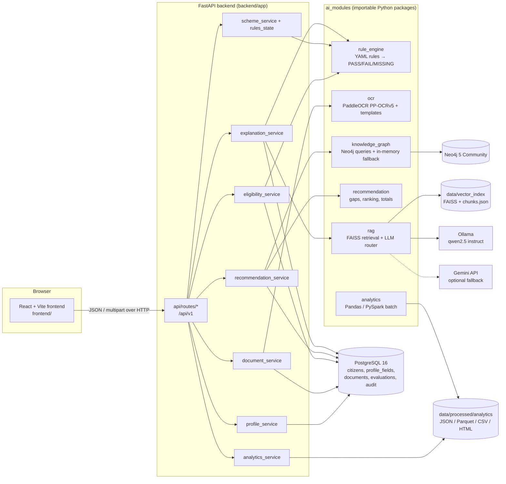
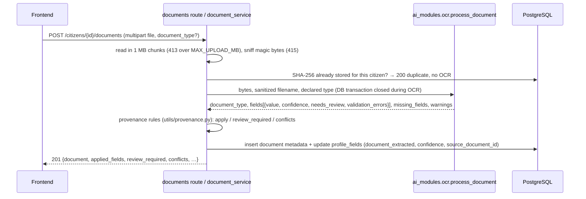
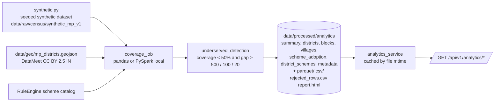

# Architecture

The design has one rule: **the deterministic rule engine is the only eligibility authority.** OCR reads documents, the knowledge graph suggests related schemes, the LLM explains, and analytics describes coverage. None of them can change an eligibility decision.

## 1. Components



Offline jobs (`scripts/`), run by a developer and not by the API:

| Script | Produces |
|---|---|
| `scripts/seed_database.py` | scheme + rule-version rows and synthetic demo citizens in PostgreSQL |
| `scripts/load_knowledge_graph.py` | Neo4j graph from the rule YAMLs + `data/geo/mp_districts.geojson` (152 nodes, 244 relationships) |
| `scripts/build_vector_index.py` | downloads the official documents listed in `data/raw/circulars/manifest.yaml` and builds `data/vector_index/` (571 chunks, 384-dim multilingual MiniLM) |
| `scripts/run_district_analytics.py --engine pandas\|spark` | `data/processed/analytics/` from the synthetic dataset in `data/raw/census/synthetic_mp_v1/` |
| `scripts/generate_synthetic_documents.py` | watermarked synthetic certificates in `data/raw/sample_documents/` |

At startup (`app.main.lifespan`):
1. The rule engine loads every YAML under `ai_modules/rule_engine/rules/`.
2. Schemes and rule versions are upserted into PostgreSQL (`rules_state.ensure_rules_synced`). This is retried from `/ready` if the database was down.
3. The knowledge graph connects to Neo4j, or falls back to the in-memory graph. It re-seeds itself if the graph content hash differs from the loaded rules.

OCR and the RAG service are imported lazily on first use, so the API starts without PaddleOCR, FAISS or the embedding model installed.

## 2. Request flows

### 2.1 Upload → OCR → profile



- Detection runs PP-OCRv5 mobile with oneDNN off; recognition runs English and Devanagari models with oneDNN on.
- YAML templates in `ai_modules/ocr/templates/` map text to fields. Values are then normalized (INR amounts, the 55 MP districts, Hindi labels) and validated.
- Aadhaar-like numbers are stripped before extraction. A Samagra number becomes `has_samagra_id = true`.
- File bytes and raw OCR text are never stored or returned.
- Values below the review threshold (0.80) or failing validation go to `review_required`.
- A value that differs from a `self_declared` or `verified` value goes to `conflicts`. The transition table is in [`data_provenance.md`](data_provenance.md).

### 2.2 Evaluate → persist

- `POST /citizens/{id}/evaluations` reads the profile (value, provenance, confidence per field).
- It calls `RuleEngine.evaluate_all(profile, as_of)` for every rule version effective on `as_of`.
- In one transaction it persists one `eligibility_evaluations` row per scheme, sharing a `run_id`, plus a `condition_results` row per condition, with group results stored as child rows.
- Each condition yields PASS, FAIL or MISSING. MISSING has a `missing_reason`: `no_value`, `insufficient_trust` (`min_trust` not met) or `low_confidence` (OCR confidence < 0.80).
- Status: any FAIL → `not_eligible`; otherwise any MISSING → `potentially_eligible`; otherwise `eligible`.
- Each row records `rule_version`, `rule_hash` and `input_hash`, so a decision can be reproduced.
- `POST /eligibility/evaluate` runs the same engine without persisting anything.

### 2.3 Recommendations → knowledge graph (or fallback)

- `GET /citizens/{id}/recommendations` loads the latest persisted run. If there is none, `refresh=true` was passed, or the run's rule version is no longer loaded, it evaluates and persists a new run first.
- It reads enrollments. `enrolled` and `applied` count as claimed.
- It queries `KnowledgeGraph.complementary_schemes(evaluated ∪ enrolled ids)`. The source is Neo4j, or `InMemoryGraph` built from the same rule YAMLs with identical query semantics. `graph_source` reports which one.
- `ai_modules.recommendation.build_recommendations` (pure and deterministic) then ranks schemes, classifies next actions (`upload_document`, `provide_information`, `obtain_verification`, `recheck_field`, `apply`), builds document gaps and computes totals without double counting.
- A suggested scheme is shown as `available` only if its **own** evaluation is eligible.

### 2.4 Explanation → RAG → LLM, with the decision guard

```mermaid
sequenceDiagram
    participant FE as Frontend
    participant XS as explanation_service
    participant RE as RuleEngine
    participant DB as PostgreSQL
    participant RAG as ExplanationService (ai_modules.rag)
    participant LLM as Ollama → Gemini → none
    FE->>XS: POST /citizens/{id}/schemes/{sid}/explanation {question?, language}
    XS->>DB: latest persisted evaluation of sid (rebuilt from condition rows with its exact rule version)
    alt none persisted
        XS->>RE: evaluate + persist
    end
    XS->>RAG: explain(evaluation, rule, question, language)
    RAG->>RAG: refuse off-topic questions, flag injection attempts
    RAG->>RAG: retrieve passages (FAISS, min score 0.32)
    RAG->>LLM: engine result + passages; instructed to explain, not decide
    LLM-->>RAG: answer with [n] markers
    RAG->>RAG: drop invalid citations; contradiction check → replace with quoted passages; grounded/uncertainty
    RAG-->>XS: Explanation(decision = engine status)
    XS->>XS: guard: explanation.decision == evaluation.status, else 500
    XS-->>FE: answer, citations, grounded, provider, uncertainty, flags, rule_version, evaluation_id
```

`POST /explain` and `POST /schemes/{id}/ask` take the same path without persistence. `/ask` has no decision (`decision: null`), and the service raises if one appears.

### 2.5 Analytics batch → outputs → API



The batch never reads production evaluations. The statuses in the input are seeded random draws, not rule-engine output, and every row and response is labelled `is_synthetic: true`. The pandas and Spark engines give identical tables; the tests assert this.

## 3. Trust boundaries

| Boundary | Rule | Enforced in |
|---|---|---|
| LLM ↔ decision | The LLM receives the finished evaluation and may only explain it. `decision` is copied from the engine. An answer contradicting it is discarded and replaced by quoted passages. The API returns 500 rather than a mismatched decision | `ai_modules/rag/service.py`, `backend/app/services/explanation_service.py` |
| User input ↔ LLM prompt | Questions ≤ 500 chars. Off-topic questions are refused without calling the LLM. Injection phrases are flagged and the question is dropped | `ai_modules/rag/service.py`, `schemas/explanation.py` |
| OCR ↔ profile | OCR values are `document_extracted`, never `verified`. Low-confidence or invalid values are not applied. User-typed values are never silently overwritten | `backend/app/utils/provenance.py`, `services/document_service.py` |
| Provenance ↔ rules | `min_trust` per condition (caste conditions need `document_extracted`). Insufficient trust gives MISSING, never FAIL | `ai_modules/rule_engine/engine.py` |
| Knowledge graph ↔ eligibility | Graph edges only suggest schemes; availability comes from that scheme's own evaluation | `ai_modules/recommendation/complementary.py` |
| Browser ↔ API | CORS allow-list (`CORS_ORIGINS`), body-size limit, magic-byte type check, `extra="forbid"` schemas, no rejected values echoed in errors. **No authentication** (synthetic data only) | `backend/app/main.py`, `errors.py` |
| PII | No Aadhaar/Samagra numbers (9+ digit runs in text fields → 422 `sensitive_identifier`), no file bytes or OCR text stored, filenames masked, logs carry ids and lengths only. `DELETE /citizens/{id}` cascades and leaves a PII-free audit row | `services/profile_service.py`, `services/document_service.py`, `models/audit.py` |
| Analytics ↔ reality | Synthetic data labelled at every level; the UI must show the label | `ai_modules/analytics/`, `schemas/analytics.py` |

## 4. Data stores

| Store | Contents | Written by | Notes |
|---|---|---|---|
| PostgreSQL (`localhost:5433`, db `aca`) | `citizens`, `profile_fields` (value, provenance, confidence, source_document_id), `benefit_enrollments`, `documents` (metadata, extracted fields, unique `(citizen_id, sha256)`), `schemes`, `scheme_rule_versions`, `eligibility_evaluations`, `condition_results`, `audit_log` | API, `seed_database.py`, Alembic (`backend/migrations/`) | Source of truth for citizens and decisions |
| Neo4j (`bolt://localhost:7687`) | Scheme, Condition, Benefit, DocumentType, Field and Region nodes; HAS_CONDITION, RESOLVED_BY, COMPLEMENTED_BY, TOPS_UP and similar edges | `load_knowledge_graph.py`, auto-seed on API start | Derived from the YAML rules; can be rebuilt at any time; optional |
| Rule YAMLs (`ai_modules/rule_engine/rules/{central,mp}/*.yaml`) | 9 schemes, 10 versions, sources, limitations | developers | Versioned; the `rule_hash` is stored with each evaluation |
| FAISS (`data/vector_index/`) | `index.faiss`, `chunks.json`, `manifest.json` | `build_vector_index.py` | Git-ignored; official documents only |
| Analytics outputs (`data/processed/analytics/`) | JSON served by the API + Parquet/CSV/HTML | `run_district_analytics.py` | Git-ignored; synthetic |
| Model caches | PaddleOCR (`~/.paddlex`, 21 MB), sentence-transformers (Hugging Face cache), Ollama models | first use / `ollama pull` | Outside the repo |

## 5. Failure modes and graceful degradation

| Failure | Effect | What the user / frontend sees | How to detect |
|---|---|---|---|
| **Neo4j down** at startup or mid-run | Knowledge graph uses `InMemoryGraph` built from the same rules; results are identical | Recommendations work; `graph_source: "fallback"` | `/ready` `checks.neo4j.status = unreachable`, `checks.knowledge_graph.source = fallback` |
| **Ollama down**, no Gemini key (or `RAG_LLM_DISABLED=1`) | No LLM text. The answer is a condition summary plus verbatim official passages | 200 with `provider: "none"`, `model: null`, flag `llm_unavailable` ([fixture](fixtures/explanation_provider_none.json)) | `/ready` `checks.ollama` |
| Ollama slow | The request waits up to `OLLAMA_TIMEOUT_S` (120 s), then tries Gemini, then `none` | Long spinner; the frontend should time out at about 150 s | `latency_ms` |
| **No FAISS index** / RAG packages missing | Explanation endpoints unavailable; everything else works | 503 `rag_unavailable` with a hint | `/ready` `checks.rag.index = absent` |
| **No PaddleOCR** installed / models fail to load | Upload unavailable; manual profile entry still works | 503 `ocr_unavailable` | upload response |
| **No Java** | Only the `--engine spark` analytics job is affected. The pandas engine gives identical outputs; the API never needs Java | — | CLI error from `spark_session.find_java` |
| Analytics outputs missing | Analytics endpoints unavailable | 503 `analytics_not_generated` with the command to run | — |
| PostgreSQL down | Citizen, profile, document, evaluation and recommendation endpoints fail fast (`DB_CONNECT_TIMEOUT_S`, default 5 s; `/ready` answers 503 in ~8 s) | 500 `internal_error`; `/ready` 503 | `/ready` `checks.database` |
| Rule YAML invalid | Rule engine not loaded; profile endpoints still work | 503 `rule_engine_unavailable` | `/ready` `checks.rule_engine` |
| Embedding model not cached and no internet | Not tested. When the model loads, sentence-transformers queries huggingface.co even if it is cached (observed in the API log), so an offline first call is expected to be slow or to fail. Pre-download the model; `HF_HUB_OFFLINE=1` should make it use the cache only | Slow first explanation, or 500 | API log |

**Configuration.** On first use of settings the backend loads the repository-root `.env` into the process environment (`load_dotenv(override=False)` in `backend/app/config.py`). Both the backend's own `Settings` fields and the `ai_modules` settings read via `os.getenv` (`OLLAMA_TIMEOUT_S`, `GEMINI_MODEL`, `RAG_*`, `ACA_OCR_*`, `NEO4J_DATABASE`, `NEO4J_CONNECT_TIMEOUT`, …) therefore apply in a native `uvicorn` run; variables already exported in the shell win. Standalone `scripts/` that don't import the backend settings read only the shell environment. In Docker Compose the backend also gets the whole `.env` via `env_file`.

## 6. Module map

| Path | Responsibility |
|---|---|
| `backend/app/main.py` | App factory, CORS, request-id + body-size middleware, lifespan (rules, graph) |
| `backend/app/config.py` | Settings from env / `.env` (`DATABASE_URL`, `CORS_ORIGINS`, `MAX_UPLOAD_MB`, Neo4j, Ollama, Gemini, paths) |
| `backend/app/errors.py` | `ApiError` and the single error envelope |
| `backend/app/api/routes/{health,profiles,documents,schemes,eligibility,recommendations,explain,analytics}.py` | HTTP layer (`/api/v1`) |
| `backend/app/services/*.py` | Business logic: profile/provenance, document upload, eligibility persistence, recommendations, explanations, analytics cache, scheme serialization, rule sync, audit |
| `backend/app/models/*.py`, `backend/migrations/` | SQLAlchemy models, Alembic migrations (`414654505a8d` initial, `6cc2e7e4d5a8` document OCR metadata) |
| `backend/app/utils/provenance.py` | Provenance transitions (user edit, OCR extraction) |
| `ai_modules/rule_engine/` | `fields.py` (field catalog, document types, provenance), `definitions.py` (rule dataclasses), `loader.py`, `operators.py`, `engine.py`, `result.py`, `rules/**.yaml` |
| `ai_modules/ocr/` | `pipeline.py` (`process_document`), `paddle_engine.py`, `documents.py` (file sniffing, PDF rendering), `field_extractor.py`, `normalizer.py`, `validator.py`, `templates/*.yaml`, `synthetic.py` |
| `ai_modules/knowledge_graph/` | `KnowledgeGraph` facade, `neo4j_client.py`, `queries.py`, `fallback.py`, `graph_builder.py`, `cypher/*.cypher` |
| `ai_modules/recommendation/` | `gap_detector.py`, `complementary.py`, `ranker.py`, `report.py` (`build_recommendations`) |
| `ai_modules/rag/` | `ingest.py`, `chunker.py`, `embedder.py`, `vector_store.py`, `retriever.py`, `llm_router.py`, `prompts.py`, `service.py` (`ExplanationService`) |
| `ai_modules/analytics/` | `synthetic.py`, `reference.py`, `coverage_job.py`, `underserved_detection.py`, `pipeline.py`, `outputs.py` (`load_outputs`), `spark_session.py`, `plotly_reports.py` |
| `frontend/` | React prototype on mock data (Parth); integration via [`frontend_integration_guide.md`](frontend_integration_guide.md) |
